# VISSTE DU AT … – alle fun facts i Løpegutten

Når du åpner en vare i spillet, viser boksen **«VISSTE DU AT …»** en tilfeldig tekst fra en liste
for den varen. Her er **alle 26 tekstene**, 
Det er 22 knyttet til varene og 4 generelle fra tips-vinduet. Under hver vare står hva vitsen går ut på.

**Nøkkelen til nesten alle vitsene:** Løpegutten er en nyversjon av freeware-spillet *Gudfaren* fra 1996
(se «Om spillet» på lopegutten.com). Varene og «Visste du at»-tekstene er kopiert rett fra originalen. Derfor
høres de ut som en skoleoppgave fra 1996 eller en brosjyre fra helsesøster, og flere av dem er feil eller
bare tull med vilje. De fire nye varene (Ecstasy, Våpen, Bomber, Vigra) har fått nye tekster skrevet i
samme stil.

Slangordene og emojiene (🍁 💉 ❄️ …) er tillegg lagt inn av meg, ikke fra spillet.

---

## 🌿 Marihuana · 8 tekster
*Gatenavn: grønt, grønning, brunt, weed, pot, rev, joint, J, jay, bom, tjall, bønne, blunt, skunk · 🍁 🌿 🍃 🍀 💨 🍫 ⛽*

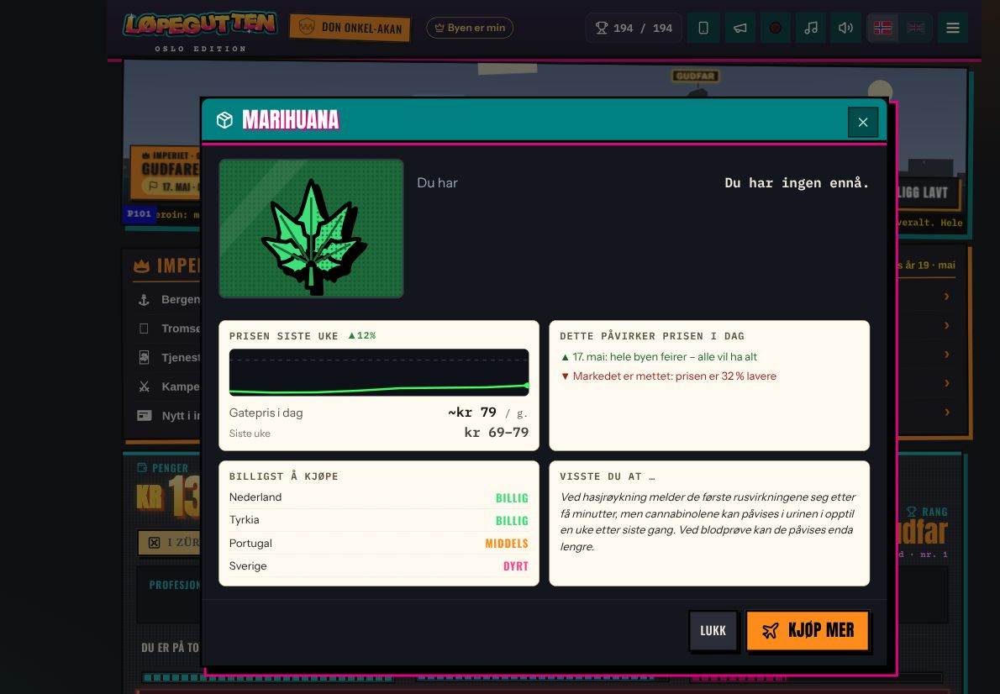

> Cannabis Sativa kan bli opptil 1.8 meter høy. Da er den 'høy' da...

> Marihuana ble brukt som en folkemedisin i sentral Asia og Kina 3000 år f.kr.

> Politiet sjekker hvor høy PH'en i urinen er når de skal sjekke om en person nylig har røykt hasj eller marihuana. Hvis du da blander f.eks såpe i urinen blir PH'en normal.

> Du har lov til å ha en Cannabis Sativa plante hvis du har mer enn 7 andre (sjeldne?) planter. Cannabis Sativa planten blir da sett på som et lovlig samleobjekt.

> De rusfremkallende stoffene i hasj (cannabinolene) finnes i forskjellige konsentrasjoner, fra 0,5% til 10%, avhengig av plantetype og vekststed.

> Hasj har vært kjent som rusmiddel i flere tusen år.

> Ved hasjrøykning melder de første rusvirkningene seg etter få minutter, men cannabinolene kan påvises i urinen i opptil en uke etter siste gang. Ved blodprøve kan de påvises enda lengre.

> Hasj blir brukt både ved innsprøytning og som tabletter, men vanligst brukes det sammen med tobakk i pipe eller sigarett.

**Vitsen:** Her er alle typene samlet.
- **Ordspill:** plante som er 1,8 meter «høy» – «Da er den 'høy' da…». En ekte pappavits fra 1996.
- **Skolefakta:** folkemedisin i Asia, flere tusen år og 0,5–10 % virkestoff høres ut som en særoppgave.
- **Skolegård-myter servert som fakta:** såpe i urinen og «lovlig samleobjekt hvis du har 7 andre planter» er
  rykter som gikk i friminuttet på 90-tallet. Ingen av dem stemmer, men de står der med samme alvor som resten.
- **Forvirret helsefakta:** hasj «ved innsprøytning og som tabletter» er rett og slett feil.
- **Spillvinkelen:** rusen varer minutter, men sporene i urinen varer en uke. Det passer et spill der alt
  handler om å holde søkelyset nede.

---

## 💉 Heroin · 2 tekster
*Gatenavn: H, minus, ned, dop, hest, smack, brunt · 💉 🐉 ⚙️*

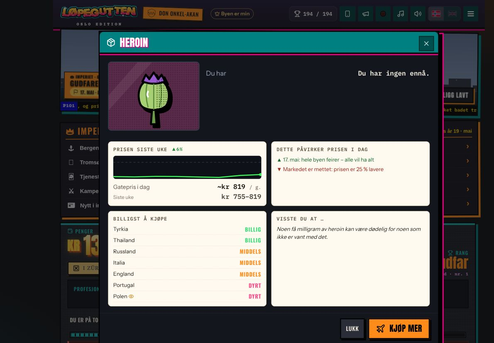

> Noen få milligram av heroin kan være dødelig for noen som ikke er vant med det.

> I Norge er det forbudt å produsere, omsette , være i besittelse av eller bruke heroin, og stoffet har heller ingen plass som legemiddel her i landet.

**Vitsen:** Vitsen er at det ikke er noen vits. Midt i et spill der du selger heroin til hele Oslo,
kommer en knusktørr oppsummering av loven. Det er som om spillet plutselig husker at det bør si fra.
Den offisielle tonen mot alle de fargerike gatestemmene gjør den morsommere enn en vits hadde vært.
Legg merke til mellomrommet foran kommaet i «omsette ,». Det er med fra originalen.

---

## 🍾 Sprit · 1 tekst

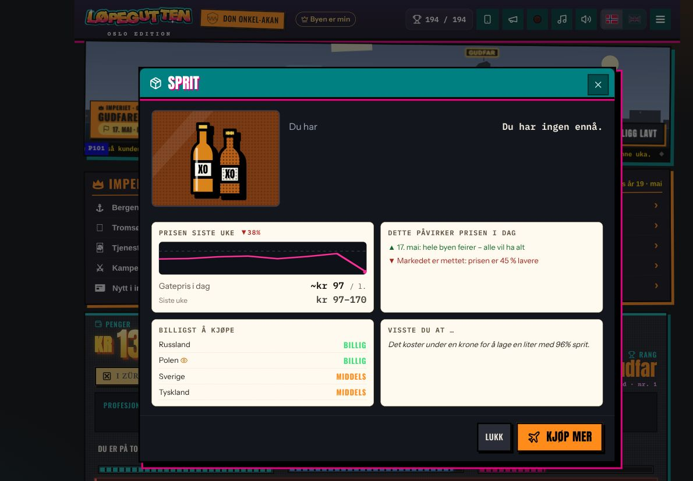

> Det koster under en krone for å lage en liter med 96% sprit.

**Vitsen:** Et stikk til Vinmonopolet. En liter sprit koster hundrevis av kroner på polet, men selve
spriten koster nesten ingenting å lage. Resten er avgift. Det er akkurat det spilleren lever av: kjøpe billig
ett sted og selge dyrt et annet. Du gjør det samme som staten, bare uten avgift.

---

## 🚬 Tobakk · 1 tekst

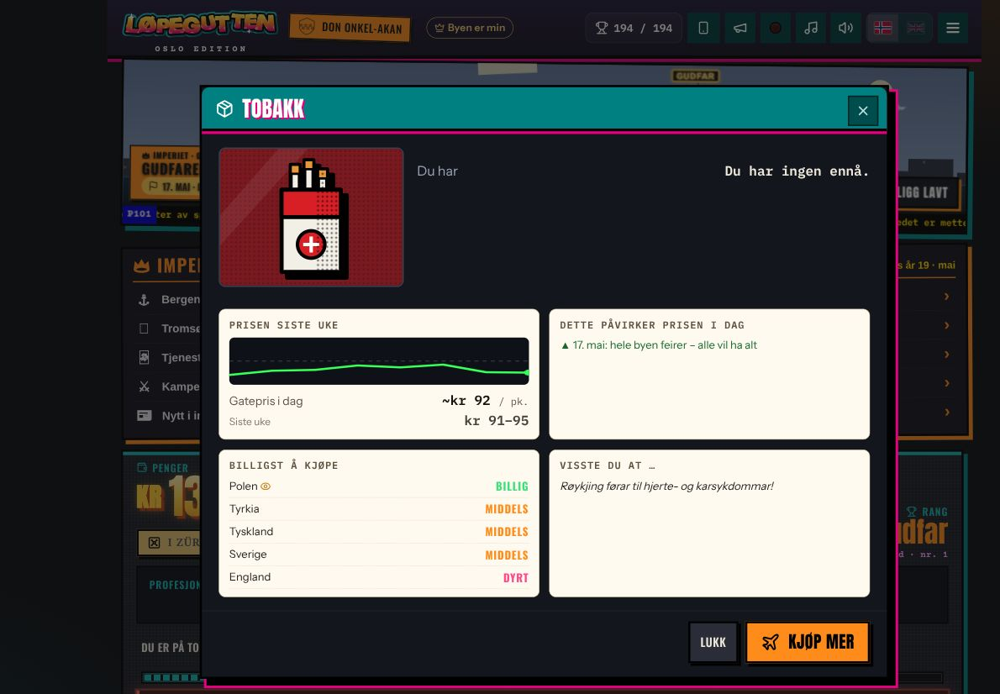

> Røykjing førar til hjerte- og karsykdommar!

**Vitsen:** Helsevesenet på besøk, på nynorsk og med utropstegn, akkurat som advarselen på en
sigarettpakke på 90-tallet. Resten av spillet snakker gate-oslosk, og så kommer denne ene setningen som er
klippet rett fra en offentlig kampanje. Og spilleren selger tobakken den advarer mot.

---

## ⚡ Amfetamin · 3 tekster
*Gatenavn: speed, fart, pepper, joggesko, makka, amf, meth, ice, crystal · 💎 🔮 ⚡*

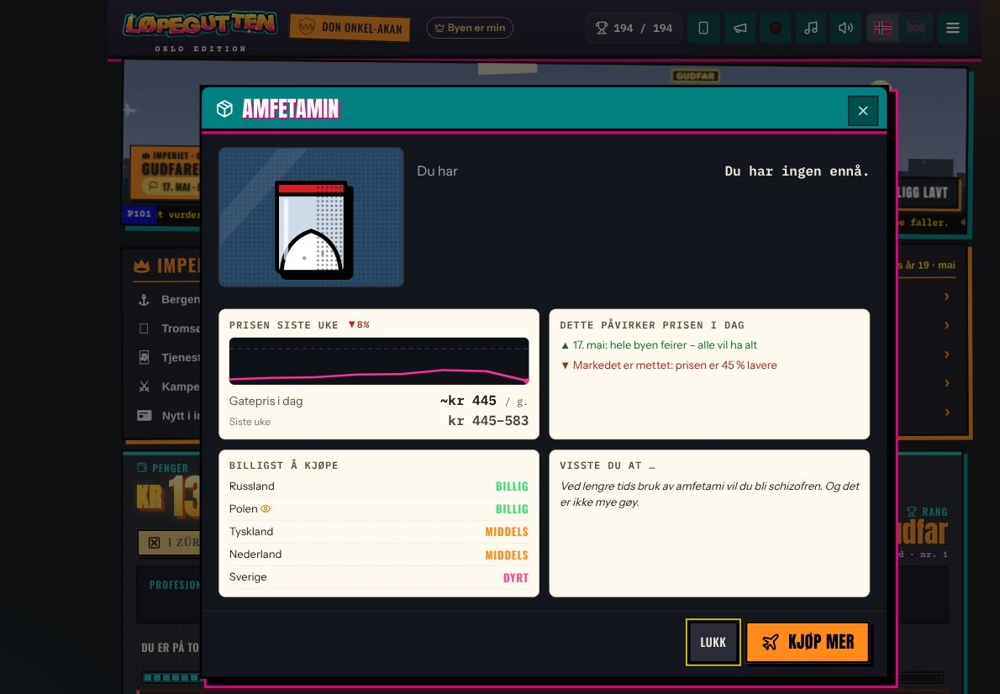
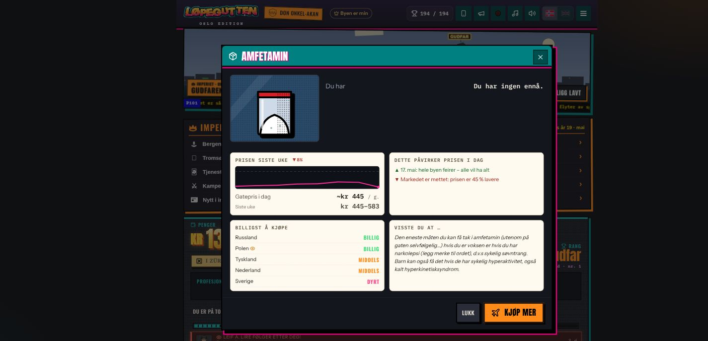

> Amfetamin ble i en periode solgt i butikker under navnet &lt;feriepillen&gt;. Den skulle gjøre slik at man opplevde mest mulig under ferien, uten søvntrang.

> Ved lengre tids bruk av amfetami vil du bli schizofren. Og det er ikke mye gøy.

> Den eneste måten du kan få tak i amfetamin (utenom på gaten selvfølgelig...) hvis du er voksen er hvis du har narkolepsi (legg merke til ordet), d.v.s sykelig søvntrang. Barn kan også få det hvis de har sykelig hyperaktivitet, også kalt hyperkinetisksyndrom.

**Vitsen:**
- **«Feriepillen»** bygger på noe ekte: amfetamin var et vanlig legemiddel på 1930–40-tallet, før det ble
  narkotika. Ideen om en pille for å slippe å sove i ferien er absurd nok i seg selv.
- **«Og det er ikke mye gøy»** er en helt flat avslutning på en skremmende påstand, og «amfetami» mangler en n.
  Helsesøster-tone møter 13-åring.
- **«narkolepsi (legg merke til ordet)»:** ordet begynner med **narko**. Spillet blunker til deg: den eneste
  lovlige veien til amfetamin går gjennom en sykdom som heter «narko-noe».
- Det stemmer faktisk at amfetamin brukes som legemiddel mot narkolepsi og ADHD («hyperkinetisk syndrom» var
  det gamle navnet på ADHD).

---

## 🍬 LSD · 4 tekster
*Gatenavn: syre, lapp, tripp, frimerke*

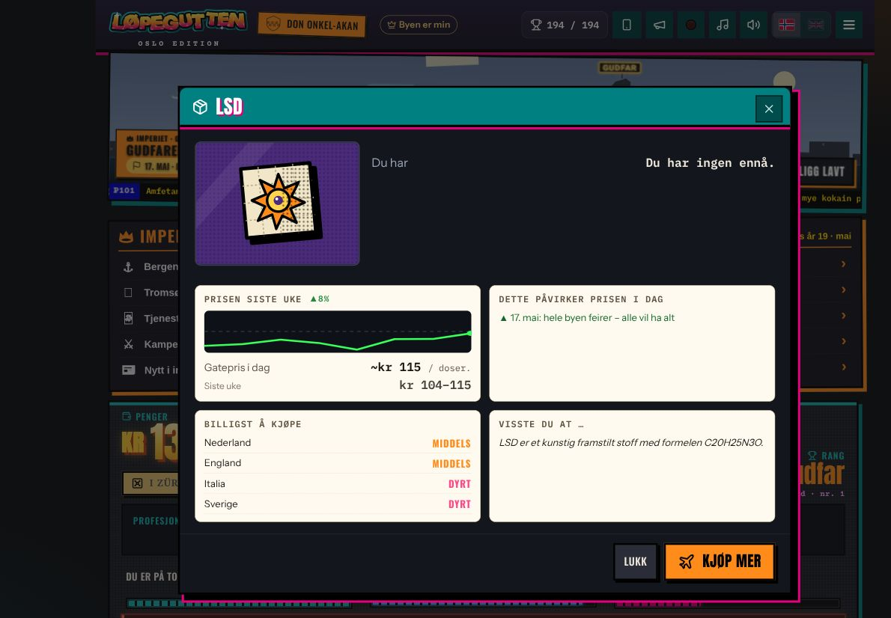

> LSD ble oppdaget i 1943 ved en tilfeldighet.

> LSD er forkortelsen for lysergsyredietylamid.

> LSD er et kunstig framstilt stoff med formelen C20H25N3O.

> LSD inntas gjennom munnen, f.eks. oppløst på en sukkerbit, i svært små doser (0,05-0,5 mg.), og virkningen kommer etter knapt 1 time og varer opptil 8 timer.

**Vitsen:** Kjemitime. Spillet snakker om tripper, og så kommer et kjemisk navn og en molekylformel
som fra en innlevering i naturfag, komplett med dosering i milligram. Kontrasten mellom fyllefest og
leksikon er vitsen. Fakta stemmer stort sett: LSD ble oppdaget ved et uhell (Albert Hofmann, 1943), og
formelen er riktig.

---

## ❄️ Kokain · 3 tekster
*Gatenavn: cola, kola, brus, snø, coke, hvitt, pulver, koks, pudder · ❄️ ☃️ 🌨️ 🎿 🎱 🔑 🍚*

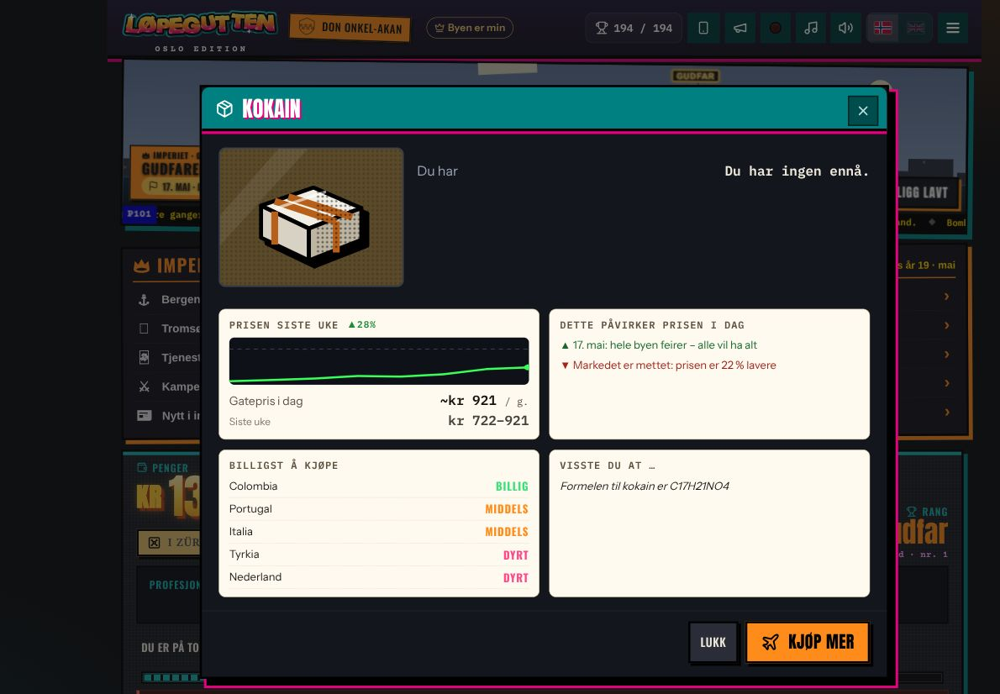

> Cokain er klassifisert som et lovlig narkotikum av den Amerikanske regjering.

> Formelen til kokain er C17H21NO4

> En spesielt farlig kokainvariant er den såkalte crack, som foreligger som krystallinske korn, men en renhetsgrad på opptil 90%. (Vanlig kokain i pulverform overstiger sjeldent 20%). Crack-kornene smeltes, og dampen opptas direkte i lungene, noe som gir en veldig øyeblikkelig og kraftig virkning.

**Vitsen:**
- **«Lovlig narkotikum av den Amerikanske regjering»** høres ut som et smutthull, men er en misforståelse fra
  1996. I USA er kokain godkjent som lokalbedøvelse hos legen, ikke lovlig å kjøpe. Den stavemåten
  («Cokain») røper at teksten er kopiert fra originalen.
- **Formelen** er samme kjemivits som LSD: læreren som har gitt opp moralprekenen og bare sier «skriv dette
  ned til prøven». Formelen er riktig.
- **Crack-teksten** er ren leksikon-alvor uten noen poeng, som en brosjyre lagt igjen på pulten.

---

## 🔫 Våpen · 1 tekst (ny)

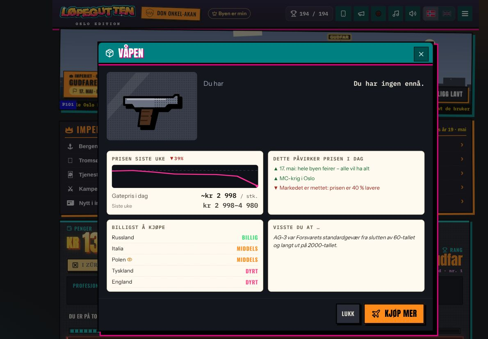

> AG-3 var Forsvarets standardgevær fra slutten av 60-tallet og langt ut på 2000-tallet.

**Vitsen:** Alle som har avtjent verneplikt i Norge kjenner AG-3. Det er en norsk versjon av det tyske
G3-geværet, og et nostalgi-nikk til alle som har pusset det i førstegangstjenesten. Hvor våpnene i spillet
kommer fra, sier teksten ingenting om. Den bare antyder.

---

## 💣 Bomber · 1 tekst (ny)

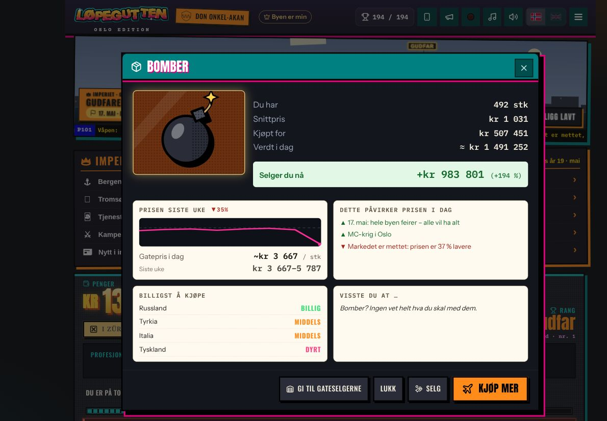

> Bomber? Ingen vet helt hva du skal med dem.

**Vitsen:** Spillet bryter den fjerde veggen. Alle andre varer får et fakta, men her gir spillet opp og
sier at det ikke vet hva du skal med dem heller. Det er en skuldertrekning fra utvikleren, og samtidig et
nikk til originalen fra 1996, der bomber bare var en vare i kofferten uten noen forklaring.

---

## 💊 Ecstasy · 1 tekst (ny)
*Gatenavn: Emma, Molly, knips, E, XTC, krystaller, piller · 💊 🍬 ⚡ ❤️*

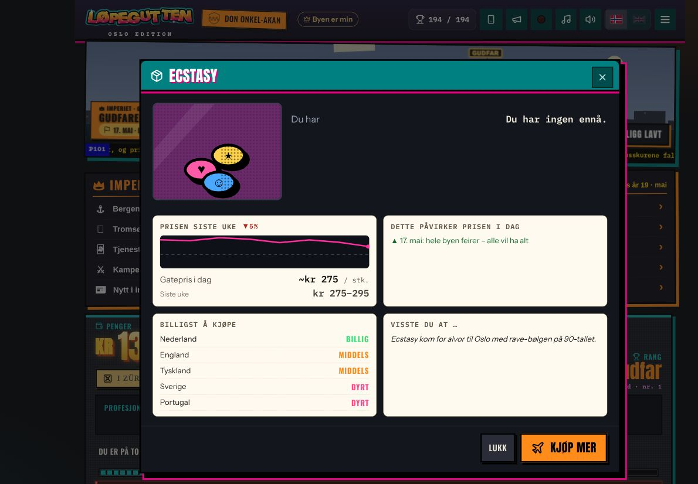

> Ecstasy kom for alvor til Oslo med rave-bølgen på 90-tallet.

**Vitsen:** Ikke en vits, men en tidsmarkør. Spillet foregår i Oslo 1990–1999, og rave-bølgen kom akkurat da.
Teksten forteller deg at du sitter midt i den, med pillene i lomma.

---

## 🔵 Vigra · 1 tekst (ny)

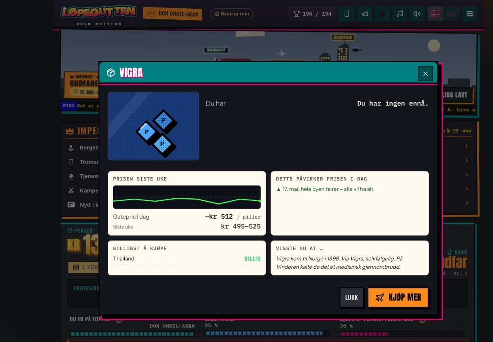

> Vigra kom til Norge i 1998. Via Vigra, selvfølgelig. På Vinderen kalte de det et medisinsk gjennombrudd.

**Vitsen:** Tredobbelt ordspill.
- **Vigra / Viagra:** varen heter Vigra, en halvveis omskrivning av potensmiddelet Viagra.
- **«Via Vigra»:** Vigra er også øya i Møre og Romsdal der Ålesund lufthavn ligger. Pillene kom altså
  «via Vigra», med fly via en flyplass med nesten samme navn.
- **Vinderen:** en rik vestkantbydel i Oslo. «På Vinderen kalte de det et medisinsk gjennombrudd» er et
  stikk til de rike, eldre herrene der.
- **Fakta som stemmer:** Viagra kom til Norge i 1998. I spillet dukker Vigra også opp først **1. april 1998**.
  Før det er varen skjult.

---

## 🍄 Fleinsopp
Fleinsopp i Tromsø har ingen «Visste du at»-tekst. Den er ikke en vanlig vare i spillet, så den har ingen
egen faktaboks.

---

## 💾 Bonus: tips-vinduet
Spillet har også et tips-vindu som viser tilfeldige tekster fra den samme lista. Disse fire hører ikke til
noen vare, og er kopiert rett fra Gudfaren 1996:

> Du når som helst kan gå ut av dette programmet ved å avslutte det!

> Dette programmet er utroligt bra! Du kan også kopiere det fritt til alle dine venner.

> Gibme.com er norges største spillside!

> Gibme.com har norges største spillforum!

**Vitsen:** Ren 90-talls-nostalgi. Det er tips fra et Windows-program på diskett: et åpenbart råd om å
avslutte programmet, en oppfordring til å kopiere spillet til vennene (freeware!), og reklame for Gibme.com,
en norsk spillside fra den tiden. De står fortsatt i spillet, og ingen har fjernet dem.

---

*Kilde: `TIPS`, `GOOD_TIPS` og `GOOD_TIPS_NEW`
